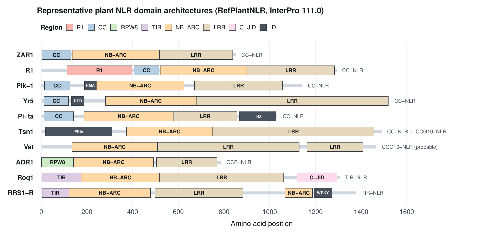
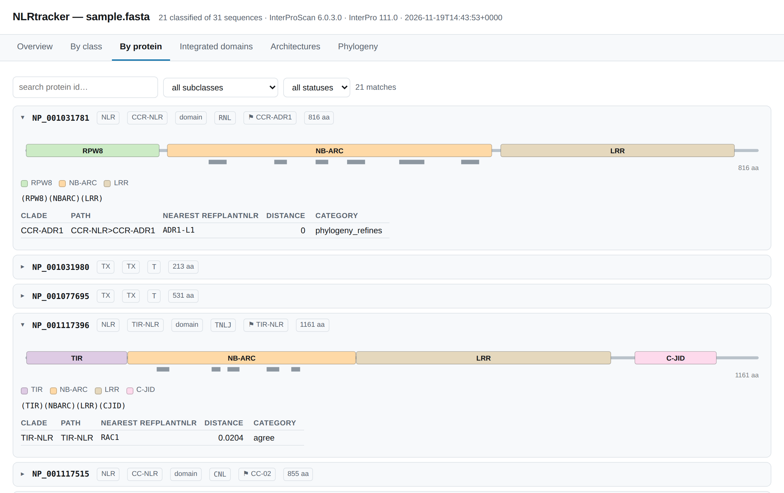

# NLRtracker

Find and annotate NLR immune receptors in a plant proteome.

Provide NLRtracker with a protein FASTA file. The pipeline identifies which proteins are NLRs, assigns each receptor to a putative subclass, defines non-overlapping domain boundaries, extracts per-domain FASTA files, builds domain-architecture figures, and writes a self-contained HTML report.

Version `2.0.3` runs on InterProScan `6.0.3.0` and InterPro `111.0`. Tested on 64-bit Linux; macOS and Windows under WSL2 are expected to work in principle but have not yet been tested (see [Platform support](#platform-support)).


*Representative RefPlantNLR architectures annotated by NLRtracker 2.0.3, spanning canonical `CC-NLR`, `CCG10-NLR`, `CCR-NLR`, and `TIR-NLR` subclasses, `R1` and `C-JID` regions, tandem `NB-ARC` domains (`RRS1-R`), and integrated domains (`HMA`, `BED`, `TRX`, `PKin`, and `WRKY`).*

## Quickstart

Run NLRtracker on the bundled test dataset after installing the dependencies and downloading InterPro `111.0` data:

```bash
./NLRtracker.sh -s sample_data/sample.fasta -o out_sample
```

Add `-p` to place each NLR NB-ARC region in the RefPlantNLR reference phylogeny:

```bash
./NLRtracker.sh -s sample_data/sample.fasta -o out_sample_phylo -p
```

For reproducible local runs without querying the InterPro Matches API, pass `-L`:

```bash
./NLRtracker.sh -s proteins.fasta -o out_dir -L -p
```

## What NLRtracker produces

A single run writes nine output groups under the directory passed to `-o`:

| Output | Contents |
|---|---|
| `NLRtracker.tsv` | Protein classification (`Status`, `Subclass (putative)`, `subclass_support`, `Domain`, simplified architecture) |
| `Domains.tsv` | Every chain, arbitrated region, integrated domain, NB-ARC motif, and LRR repeat row |
| `summary.tsv` | Counts by classification, arbitrated region, and signature across the 231 curated entries |
| `sequences/` | `NLR.fasta`, `NLR.lst`, `NLR-associated.fasta`, `NBARC.fasta`, `NBARC_deduplicated.fasta`, and one FASTA per region |
| `figures/` | Paginated domain-architecture PDFs (`NLR.pdf`, `NLR-associated.pdf`, and `by_subclass/*.pdf`) |
| `report.html` | Self-contained interactive report that opens locally in any browser |
| `annotations/` | `NLR.gff3`, `NLR-associated.gff3`, `iTOL.txt`, `iTOL_dedup.txt`, and `iTOL_tree.txt` |
| `phylogeny/` | Created with `-p`: `NB-ARC.aln`, `NB-ARC.tree`, `NB-ARC.rooted.tree`, clade assignments, discrepancies, and unplaced lists |
| `run_info.yaml` | Run provenance recording tool versions, InterPro release, applications, batch size, and counts |


*Interactive `report.html` generated on `sample_data/sample.fasta` with `-p`, showing per-protein domain schematics, NB-ARC motifs, and phylogenetic clade assignments.*

### Accuracy on RefPlantNLR

Evaluated against the 481 experimentally validated plant NLRs in RefPlantNLR ([Kourelis *et al.*, 2021](https://doi.org/10.1371/journal.pbio.3001124)) using InterPro `111.0`:

- **Domain-architecture classification alone (`NLRtracker.tsv`, without `-p`):**
  - **457 exact matches (95.0%)** against published subclasses
  - **23 honest ambiguities (4.8%)** that name the true subclass inside an explicit range such as `CC-NLR or CCG10-NLR`
  - **1 undetermined call (0.2%)** (`SpNBS-LRR`), which carries no subclass evidence in any member database
- **With phylogenetic classification (`-p`, `phylogeny/clade_assignment.tsv`):** Placing each NB-ARC region leave-self-out against the remaining reference scaffold resolves 22 of the 23 domain-ambiguous proteins plus `SpNBS-LRR` (`CCG10-NLR`), yielding **480 exact subclass matches (99.8%)**, **0 wrong calls**, and **1 unplaced protein** (`AtNRG1.3`, which lacks an NB-ARC domain and keeps its ambiguous domain call). This leave-self-out evaluation is an in-scaffold clade check (closely related alleles such as `Pm5a`, `Pm5b`, and `Pm5e` remain in the reference tree) rather than an independent out-of-sample benchmark.

## Requirements and installation

You need six command-line tools plus about 45 GB of disk space for the InterProScan `6.0.3.0` / InterPro `111.0` data bundle.

| Requirement | Minimum version | Purpose |
|---|---|---|
| [Nextflow](https://www.nextflow.io/) | `25.10.4` | Orchestrates InterProScan `6.0.3.0` |
| Container runtime | Docker, SingularityCE, or Apptainer | Runs member database containers |
| R | `4.1` | Region arbitration, classification, figures, HTML report, and phylogeny |
| [HMMER](http://hmmer.org/) | `3.3` | `hmmsearch` for C-JID and NB-ARC regions; `hmmalign` for `-p` |
| [MEME Suite](https://meme-suite.org/) | `5.2` | `fimo` for NLR motif scanning |
| [VeryFastTree](https://github.com/citiususc/veryfasttree) or [FastTree](http://www.microbesonline.org/fasttree/) | `4.0` or `2.1` | Phylogeny construction under `-p` (falls back to `FastTree` if `VeryFastTree` is absent) |

You do not need to install InterProScan or `mafft` separately. Nextflow fetches the `ebi-pf-team/interproscan6` `6.0.3.0` workflow automatically, and `NB-ARC_region.hmm` ships pre-built in `module/reference/`.

Install the required R packages:

```r
install.packages(c("dplyr", "tidyr", "readr", "stringr", "tibble", "purrr",
                   "ggplot2", "scales", "jsonlite", "ape"))
if (!requireNamespace("BiocManager", quietly = TRUE)) install.packages("BiocManager")
BiocManager::install("Biostrings")
```

Download the InterPro `111.0` reference data and point `INTERPROSCAN_DATADIR` to it (default `~/Bioinformatics/interproscan6/data`):

```bash
nextflow run ebi-pf-team/interproscan6 -r 6.0.3.0 -profile docker,test \
  --datadir /path/to/interproscan6/data --interpro 111.0
export INTERPROSCAN_DATADIR=/path/to/interproscan6/data
```

Run the fast offline regression check after installation:

```bash
bash tests/run_tests.sh
```

## Running NLRtracker

NLRtracker accepts **protein FASTA files only**. Nucleotide input (`-t n`) was retired in `2.0.3`; translate transcripts or coding sequences into proteins first before running the pipeline.

```bash
./NLRtracker.sh -s proteins.fasta -o out_dir [options]
```

### Command-line options

```text
Required:
  -s FILE     Protein sequence FASTA
  -o DIR      Output directory

Reuse existing tool output (skips that step):
  -i FILE     InterProScan 6 TSV result
  -f FILE     FIMO result (.gff)
  -X FILE     HMMER result (hmmsearch --domtblout)

Reference data:
  -m FILE     meme.xml for FIMO            [module/meme.xml]
  -x FILE     HMM for hmmsearch            [module/abe3069_Data_S1.hmm]
  -d FILE     InterPro entry list          [module/InterPro_111.0.list]
  -D DIR      InterProScan data directory  [$INTERPROSCAN_DATADIR or
                                            ~/Bioinformatics/interproscan6/data]

Execution:
  -c INT      CPUs per InterProScan task   [2]
  -b INT      InterProScan batch size      [auto]
  -w INT      Max concurrent tasks         [all available processors]
  -P NAME     Container profile: docker | singularity | apptainer  [docker]
  -p          Also classify phylogenetically against RefPlantNLR
  -L          Disable the InterPro Matches API (fully local, reproducible)
  -k          Keep the Nextflow work directory
  -h          Help
```

### Reusing InterProScan outputs

InterProScan accounts for most of the runtime. When testing changes to the signature tables or running `-p` on an already annotated proteome, reuse the cached intermediate outputs:

```bash
./NLRtracker.sh -s proteins.fasta -o out_reclassified \
  -i out_dir/raw/interproscan/input.normalised.fasta.tsv \
  -f out_dir/raw/fimo/fimo.gff \
  -X out_dir/raw/hmmer/CJID.domtblout \
  -p
```

## Output columns and evidence tiers

`NLRtracker.tsv` contains six columns:

| Column | Meaning |
|---|---|
| `seqname` | Protein identifier (truncated at first whitespace, `/` removed to match InterProScan) |
| `Status` | `NLR`, `degenerate NLR`, `CCX`, `RPW8`, `TX`, `CJID`, `MLKL`, `NACHT`, or `likely non-plant NLR` |
| `Subclass (putative)` | `CC-NLR`, `TIR-NLR`, `CCR-NLR`, `CCG10-NLR (probable)`, explicit ambiguity such as `CC-NLR or CCG10-NLR`, `TN (OTHER)`, or `UNDETERMINED` |
| `subclass_support` | Evidence tier backing the subclass call |
| `Domain` | Ordered region architecture, for example `(CC)(NBARC)(LRR)` |
| `Domain architecture simplified` | One-letter code per region, for example `CNL` |

### Interpreting `subclass_support`

Two proteins labelled `CC-NLR` may rest on very different evidence: one carries a recognised N-terminal coiled-coil domain, whereas another carries only a lineage-correlated winged-helix marker inside the NB-ARC. The `subclass_support` column exposes that distinction.

| Tier | Evidence used | RefPlantNLR calls | Wrong calls |
|---|---|---:|---:|
| `domain` | Diagnostic N-terminal domain (`CC`, `TIR`, `RPW8`, `CblN`, or `C-JID`) | 443 | 0 |
| `lineage` | NB-ARC winged-helix marker without an N-terminal domain | 23 | 0 |
| `probable` | Gated multi-signature rule (`CCG10-NLR` via `PF23247` without `PF18052`/`cd14798`) | 11 | 0 |
| `motif` | MEME motifs only | 2 | 0 |
| `supporting` | Low-coverage corroborating LRR signature | 1 | 0 |
| *(empty)* | No subclass evidence detected (`UNDETERMINED`) | 1 | 1 |

Every call carrying non-empty `subclass_support` is 100% accurate on RefPlantNLR. Treat `CCG10-NLR (probable)` as high-precision when present (11/11 on RefPlantNLR), while remembering that 8 of 19 RefPlantNLR CCG10-NLRs lack `PF23247` and instead report `CC-NLR or CCG10-NLR` under `lineage` support.

## Boundary arbitration and integrated domains

Raw InterProScan signatures frequently overlap across domain boundaries. Version `2.x` anchors every NLR on its NB-ARC (or bare P-loop) and resolves overlaps in fixed order:

1. Build `NB-ARC` regions from `NB-ARC_region.hmm` (`LENG 382`, joining split envelopes backed by FIMO motif continuity, spanning signatures, or a 30-residue gap backstop).
2. Truncate N-terminal regions (`TIR`, `CC`, `RPW8`, `R1`) to end before the nearest overlapping `NB-ARC` or `PLOOP`.
3. Truncate `LRR` to start after the `NB-ARC` or `PLOOP` ends.
4. Truncate `C-JID` to start after the `LRR` ends.
5. Subtract canonical regions from integrated-domain (`ID`) intervals so fused domains remain intact without overlapping core NLR domains.

Any region trimmed out of existence is recorded in `raw/logs/dropped_regions.tsv`. Because all final regions are strictly disjoint, FASTA files in `sequences/` can enter multiple sequence alignments directly without manual trimming.

## Phylogenetic classification (`-p`)

With `-p`, NLRtracker aligns extracted `NB-ARC` regions (covering at least 50% of the 382 match states) against `module/reference/NB-ARC_region.reference.fasta` (500 reference NB-ARC regions from the 481 published RefPlantNLR proteins plus four divergent *Nicotiana benthamiana* TNP TIR-NLR outgroup sequences) using `hmmalign` and `VeryFastTree` (falling back to `FastTree` when `VeryFastTree` is absent).

- **Rooted tree and tip strips:** `phylogeny/NB-ARC.tree` keeps the raw unrooted output with full tip identifiers restored, `phylogeny/NB-ARC.rooted.tree` holds the outgroup-rooted and ladderised tree used for all clade calls, and `annotations/iTOL_tree.txt` matches every tip in the rooted tree (including `_(n)` tandem-copy labels and all 500 scaffold tips).
- **23 active clades:** `module/nlr_clades.tsv` defines `TNP` (outgroup) plus 22 anchored clades with `PHYLO_ANCHOR_QUORUM = 1.00`, nested subfamily parents (`CNL8`, `CNL6`, and `ZfBED` under `CC-01`; `Pik-1`, `Pik-2`, `RGA4`, `RGA5`, `RPP13`, and `CNL4` under `CC-02`), and `DAR5` placed in `CCR-NRG1`. Outgroup tips report `TNP` with category `outgroup`.
- **Lineage fallback for paraphyletic clades:** Because `TIR-NLR` nests inside the broader CC radiation, `CC-NLR` spans more than 90% of reference tips and acts as a nearest-informative-reference lineage fallback rather than overriding nested clades.

## Reference tables and InterPro updates

Biological mappings live in three TSV files under `module/` (`231` signatures in `nlr_signatures.tsv`, `41` domain classes in `nlr_classes.tsv`, and `1` multi-signature rule in `nlr_subclass_rules.tsv`), paired with `module/InterPro_111.0.list` (`72,944` InterPro `111.0` entries). Seven InterProScan analyses run by default: `pfam,cathgene3d,superfamily,prints,smart,cdd,prosite-profiles`. `prosite-patterns` stays disabled because none of the 231 curated signatures relies on it. See [`docs/signatures.md`](docs/signatures.md) for signature roles and [`docs/nbarc-hmm.md`](docs/nbarc-hmm.md) for NB-ARC HMM details.

To refresh metadata tables against a future InterPro release:

```bash
git show v1.0.3:module/NLRtracker.R > /tmp/NLRtracker.legacy.R
python3 module/build_signature_table.py \
  --entries $INTERPROSCAN_DATADIR/interpro/<ver>/entries.json \
  --legacy /tmp/NLRtracker.legacy.R \
  --outdir module \
  --interpro-version <ver>
```

## Performance and parallelisation

NLRtracker auto-sizes InterProScan `batchSize` from physical CPU cores (`/proc/cpuinfo` or `lscpu` on Linux, `sysctl hw.physicalcpu` on macOS, falling back to `getconf _NPROCESSORS_ONLN`) so small datasets saturate available cores. Measured on 24 physical cores with `-L` (Matches API off):

| Input | Upstream default (`-b 5000`) | Auto-sized (`-b`) | Speedup |
|---|---:|---:|---:|
| 481 sequences (`RefPlantNLR`) | 776 s | 197 s (`-b 64`) | 3.93x |
| 6,000 sequences | 1,368 s | 437 s (`-b 250`) | 3.13x |

See [`docs/performance.md`](docs/performance.md) and [`docs/interproscan6-notes.md`](docs/interproscan6-notes.md) for batch-size and SMART prefilter caveats.

## Platform support

NLRtracker `2.0.3` is tested on 64-bit Linux (`x86_64`). macOS (Apple Silicon `M1` and newer) and Windows (`WSL2`) have not yet been tested; both are expected to work in principle with the caveats below.

| Component | Linux (`x86_64`) | Windows (`WSL2`) | macOS (`Apple Silicon M1+`) |
|---|---|---|---|
| `NLRtracker.sh` | Tested (native bash) | Untested (expected native in WSL2 bash) | Untested (expected native; `sha256sum` test needs GNU coreutils) |
| InterProScan `6.0.3.0` containers | Tested (native `linux/amd64`) | Untested (native `linux/amd64` via Docker Desktop WSL2 backend) | Untested (`linux/amd64` images only; runs under Rosetta 2 or QEMU emulation) |
| R, `HMMER`, `MEME`, `VeryFastTree` / `FastTree` | Tested (native) | Untested (native Linux builds inside WSL2) | Untested (native `osx-arm64` builds via Bioconda or Homebrew) |

- **Windows (`x86_64` via WSL2):** Native Windows PowerShell and Command Prompt are unsupported, because Nextflow and InterProScan `6` require POSIX paths and shell execution. Inside an Ubuntu or Debian WSL2 distribution backed by Docker Desktop, `linux/amd64` containers and all host dependencies run natively without architecture translation (Windows-on-ARM shares the emulation caveats below).
- **macOS (Apple Silicon `M1`–`M4`):** All host tools (`Nextflow`, R, `Biostrings`, `ape`, `HMMER`, `MEME`/`fimo`, `VeryFastTree`, and `FastTree`) distribute native `osx-arm64` builds via Bioconda or Homebrew. However, all eight InterProScan `6.0.3.0` Docker images NLRtracker calls are published for `linux/amd64` only, so Docker Desktop must translate them via Rosetta 2 or QEMU: scans run slower, require at least `8–16 GB` of allocated Docker memory, and remain untested for x86 SIMD instruction incompatibilities inside member-database binaries such as `pftools`.

## Troubleshooting

- **Symlinked `~/.nextflow` or container mount errors:** `NLRtracker.sh` resolves `outdir`, `fasta`, `datadir`, and `NXF_HOME` physically (`pwd -P`) so Nextflow's `bin/` directory mounts inside Docker containers cleanly. If you relocate Nextflow caches, point `NXF_HOME` to a directory accessible to Docker.
- **Session lock collisions:** Each run executes Nextflow inside `<outdir>/raw/interproscan/`, isolating `.nextflow/` locks so multiple jobs can run concurrently from the same repository checkout.
- **Retired `-t n` option:** Passing `-t n` stops immediately with a message asking you to translate nucleotide FASTA to protein sequences before running NLRtracker.
- **Pfam `39.0` (`InterPro 111.0`) `PF00931.30` shift on `TN2`:** `PF00931.30` shortened from `175` to `152` aa in Pfam `39.0`, so `TN2` loses its `PF00931` hit and reports `Status = degenerate NLR` while retaining its `TIR-NLR` subclass and its `NB-ARC` region (`168–374`) from `NB-ARC_region.hmm`.
- **Docker memory on macOS:** Raise Docker Desktop's memory limit to at least `8–16 GB` so InterProScan tasks do not exit with status `137`.

## Upgrading from 1.x

1. Outputs moved into subdirectories (`sequences/NLR.fasta`, `annotations/NLR.gff3`, `figures/NLR.pdf`).
2. `NBARC.fasta` and region coordinates reflect the locked `382`-state HMM and non-overlapping arbitration.
3. `-i` requires an InterProScan `6` TSV file, not an InterProScan `5` GFF3 file.
4. `refplantnlR` `0.2.0` or later is required if loading `Domains.tsv` into external plotting code.

## Citation

If you use NLRtracker, please cite:

- **RefPlantNLR:** Kourelis J, Sakai T, Adachi H, Kamoun S (2021). *RefPlantNLR is a comprehensive collection of experimentally validated plant disease resistance proteins from the NLR family.* PLoS Biology 19(10): e3001124. [doi:10.1371/journal.pbio.3001124](https://doi.org/10.1371/journal.pbio.3001124)
- **InterPro:** Blum M *et al.* (2025). *InterPro: the protein sequence classification resource in 2025.* Nucleic Acids Research 53(D1): D444–D456. [doi:10.1093/nar/gkae1082](https://doi.org/10.1093/nar/gkae1082)
- **MEME Suite:** Bailey TL *et al.* (2015). *The MEME Suite.* Nucleic Acids Research 43(W1): W39–W49. [doi:10.1093/nar/gkv416](https://doi.org/10.1093/nar/gkv416)
- **NLR-Annotator motifs:** Steuernagel B *et al.* (2020). *The NLR-Annotator tool enables annotation of the intracellular immune receptor repertoire.* Plant Physiology 183(2): 468–482. [doi:10.1104/pp.19.01273](https://doi.org/10.1104/pp.19.01273)
- **C-JID model:** Ma S *et al.* (2020). *Direct pathogen-induced assembly of an NLR immune receptor complex to form a holoenzyme.* Science 370(6521): eabe3069. [doi:10.1126/science.abe3069](https://doi.org/10.1126/science.abe3069)

## Version history

### 2.0.3

- Updated InterProScan default to `6.0.3.0` and InterPro release to `111.0` (`72,944` entries in `module/InterPro_111.0.list`), updating 4 signature metadata rows with zero withdrawn signatures and keeping all `231` signatures and `prosite-patterns` disabled.
- Launched Nextflow inside `<outdir>/raw/interproscan/` with physically resolved paths (`pwd -P`) and `NXF_HOME` resolution, and detected physical CPU cores via `/proc/cpuinfo` before `lscpu`/`sysctl`/`getconf`.
- Retired `-t n` nucleotide input cleanly.
- Backported evidence-based split NB-ARC HMM envelope joining (FIMO motif order, spanning signature, and 30-residue gap backstop; joins `Rpp4C4` into one NB-ARC region).
- Fixed phylogeny handling: honoured `FastTree` fallback, normalised `/` and `_(n)` tip/anchor lookups, raised `PHYLO_ANCHOR_QUORUM` to `1.00`, retained query proteins matching scaffold IDs, wrote `NB-ARC.rooted.tree`, protected `TNP` outgroups (`outgroup` category), keyed `annotations/iTOL_tree.txt` on tree tips, updated `module/nlr_clades.tsv` to `23` active clades (`DAR5` in `CCR-NRG1`, nested parents), and regenerated the 500-region scaffold.
- Removed dead `support` column selection in `module/R/07_report.R` and removed committed `.Rhistory` and legacy InterPro `5.53-87.0.list`.

### 2.0.2

- Fixed identifier normalisation in `tests/score_refplantnlr.py` (`/` removal matching InterProScan), restoring accurate scoring (`457` exact, `23` ambiguous, `1` wrong across all `481` RefPlantNLR entries).

### 2.0.1

- Preserved exact tree tip labels in `NB-ARC.tree` and set default `VeryFastTree` threads to `1` for reproducible trees.

### 2.0.0

- Migrated wrapper to InterProScan `6.0.1` (`InterPro 109.0`), data-driven signature tables (`231` signatures), gated `CCG10-NLR` rule, arbitrated non-overlapping regions, per-region FASTAs, automatic PDFs, HTML report, and optional `-p` phylogeny.

### 1.0.3 and earlier

See [`docs/CHANGELOG-1.x.md`](docs/CHANGELOG-1.x.md).

## Licence

MIT. See [`LICENSE`](LICENSE).
